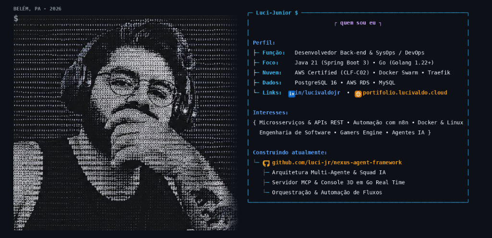

<a id="readme-top"></a>

<div align="center">


# Nexus Dual Boot

### *Seletor de Boot UEFI Universal, Seguro e Estilizado em Estética Oriental Nanquim (Sumi-e) para o Nexus Ecosystem*

[](https://github.com/luci-jr)
[](https://microsoft.com)
[](#)
[](#)
[](https://www.rodsbooks.com/refind/)
[](LICENSE)

</div>

---

> 💻 **Compatibilidade Universal:** Funciona nativamente com **Windows 10/11** e qualquer distribuição Linux moderna (**Ubuntu**, **Fedora**, **CachyOS**, **Arch Linux**, **Linux Mint**, **Pop!_OS**, **Debian**).

---

## 🧭 Índice Rápido de Navegação

| Seção | Conteúdo & Foco |
| :--- | :--- |
| [💡 A Ideia, a Origem & a Dor Real](#-a-ideia-a-origem--a-dor-real) | O fim do GRUB feioso e o nascimento da estética Sumi-e |
| [🎯 Pilares de Engenharia & Blindagem](#-pilares-de-engenharia-e-blindagem) | Handoff seguro, Boot Guard, timeout zero e isolamento |
| [📂 Estrutura do Projeto](#-estrutura-do-projeto) | Mapa completo dos scripts, assets Nanquim e configs |
| [🚀 Como Usar](#-como-usar) | Trilha em 3 passos: VM QEMU, Auto-Discovery e Deploy |
| [🔄 Como Desinstalar com Segurança](#-como-desinstalar-com-segurança) | Limpeza atômica da NVRAM e restauração do estado original |
| [👨‍💻 Desenvolvedor & Arquiteto](#autor) | Perfil do autor, manifesto profissional e canais de contato |

<div align="right"><a href="#readme-top"></a></div>

---

## 💡 A Ideia, a Origem & a Dor Real

Se tu usas dual-boot no dia a dia, conheces bem essa frustração: tu investes em hardware moderno, tela de alta fidelidade (Full HD, 2K ou Ultrawide), teclado mecânico e ambiente de desenvolvimento impecável... **mas ao ligar a máquina, a primeira coisa que aparece é aquela tela feiosa e crua do GRUB padrão**.

### ⚠️ A Dor do GRUB Tradicional

* 🖥️ **Estética Ultrapassada e Imagem Esticada:**  
  O GRUB tradicional parece congelado nos anos 90: texto monocromático serrilhado, proporções esticadas em monitores modernos (renderizando em 800x600 ou 1024x768 deformado), poluição de linhas de terminal e zero polimento visual. **Simplesmente não dá mais para aceitar essa experiência toda vez que se liga a máquina.**
* ⏳ **O Inconveniente do "Boot Afobado":**  
  Tu ligas o PC, vais até a cozinha pegar um café ou uma água, e quando voltas à bancada o GRUB já deu boot sozinho no sistema errado só porque um contador arbitrário de 5 ou 10 segundos esgotou.
* 💥 **Instabilidade e Medo Constante de Quebras:**  
  Basta um `apt upgrade` atualizar o kernel ou o Windows Update instalar um patch cumulativo para surgir o receio de o bootloader quebrar, a ordem da NVRAM ser sequestrada pelo Windows ou a partição EFI ficar desconfigurada.

---

### ✨ A Ideia de Criação: Elegância Visual com Blindagem de Engenharia

O **Nexus Dual Boot** nasceu para transformar o ritual diário de ligar a máquina em uma experiência de alta classe, calma e sobriedade técnica:

* 🎨 **Estética Zen em Nanquim (Sumi-e):** Uma tela limpa, com contraste harmônico, wallpaper artístico em alta definição e ícones caligráficos desenhados sob medida para cada sistema operacional.
* 🖥️ **Resolução Nativa Sem Distorção:** Renderização direta em 1080p Full HD e Ultrawide (2560x1080), sem borrões ou fontes esticadas.
* ⏱️ **Tempo do Desenvolvedor (`timeout 0`):** O seletor espera pacientemente pela tua decisão manual. Pressiona `Enter` apenas quando estiveres pronto.
* 🛡️ **Handoff Seguro (Zero Conflito com Kernels):** Em vez de tentar gerenciar kernels diretamente, o Nexus atua como um despachante visual de elite e repassa o controle para os inicializadores assinados oficiais (`shimx64.efi` e `bootmgfw.efi`). Atualizações de SO acontecem normalmente sem risco de corrupção.

| O GRUB Feião Tradicional ❌ | Nexus Dual Boot (Nanquim Zen) ✅ |
| :--- | :--- |
| 🪟 Texto serrilhado e resolução esticada (800x600) | 💎 **Resolução nativa 1080p e Ultrawide 2560x1080 cristalina** |
| 🏃‍♂️ Contagem regressiva afobada que inicia o SO errado | 🧘‍♂️ **`timeout 0`: espera tua seleção sem pressa alguma** |
| 📋 Menus cheios de opções desnecessárias de rescue/memtest | 🎯 **Apenas teus sistemas operacionais e botões essenciais** |
| ⬛ Visual de terminal cru e sem identidade visual | 🖌️ **Estética oriental Nanquim (Sumi-e) com ícones dedicados** |
| ⚠️ Risco de quebra a cada update de kernel ou Windows | 🛡️ **Handoff limpo e serviço de proteção de boot (Boot Guard)** |

<div align="right"><a href="#readme-top"></a></div>

---

## 🎯 Pilares de Engenharia e Blindagem

1. 🛡️ **Blindado Contra Atualizações de Kernel (Handoff UEFI Seguro):**
   * O Nexus Dual Boot atua como um despachante UEFI de alto nível. Ele **não carrega kernels diretamente**.
   * Ele delega a execução diretamente para o inicializador oficial da tua distribuição (`shimx64.efi`, `grubx64.efi` ou `systemd-bootx64.efi`).
   * Quando tu rodas `apt upgrade`, `dnf update` ou `pacman -Syu` e o kernel é atualizado, o GRUB/loader interno da distro recompila suas configurações normalmente. **O Nexus Dual Boot continua funcionando perfeitamente sem quebras**.

2. 🔒 **Blindado Contra o Windows Update (Nexus Boot Guard):**
   * Um serviço leve do systemd (`nexus-boot-guard.service`) monitora o estado da NVRAM a cada boot. Se uma atualização do Windows tentar colocar o "Windows Boot Manager" como prioritário, o Nexus restaura a ordem de boot automaticamente.
   * Cópia de contingência registrada em `/EFI/BOOT/BOOTX64.EFI` para imunidade caso a placa-mãe sofra reset de NVRAM/CMOS.

3. ⏳ **Sem Boot Afobado (`timeout 0`):**
   * O computador aguarda tua seleção manual indefinidamente. Sem contadores regressivos indesejados.

4. 🔍 **Multi-Distro Plug-and-Play com Auto-Discovery:**
   * O motor `auto-setup.sh` escaneia a partição EFI em busca de qualquer sistema operacional instalado e gera o `refind.conf` sob medida com ícones em estilo caligráfico nanquim.

5. 📦 **Isolamento Total na Partição ESP:**
   * Instalado no diretório dedicado `/boot/efi/EFI/nexus-duall-boot/`. Nenhum arquivo do Windows ou da tua distribuição é sobrescrito ou danificado.

<div align="right"><a href="#readme-top"></a></div>

---

## 📂 Estrutura do Projeto

```text
nexus-duall-boot/
├── auto-setup.sh        # Motor de auto-discovery de SOs e gerador de configuração
├── install.sh           # Instalador universal seguro (multi-distro)
├── uninstall.sh         # Desinstalador seguro com restauração do estado original
├── test-vm.sh           # Simulador visual em máquina virtual (QEMU 100% isolado)
├── refind.conf          # Configuração cirúrgica de boot e tema
├── refind_x64.efi       # Binário oficial x86_64 do motor de boot
├── README.md            # Documentação técnica e operacional
├── docs/assets/         # Assets visuais da documentação e branding
│   ├── nexus_logo.png   # Logo oficial do ecossistema
│   └── profile-card.png # Card executivo do desenvolvedor
└── theme/               # Assets visuais exclusivos em Nanquim (Sumi-e)
    ├── nexus.png        # Ícone oficial de alta fidelidade do Nexus Ecosystem
    └── nanquim/
        ├── background/  # Wallpaper oficial em alta definição
        │   └── background.png
        ├── ui/          # Indicadores de seleção com pincelada inclinada e glow
        │   ├── selection-big.png
        │   └── selection-small.png
        ├── icons/       # Botões de utilitários (Desligar, Reiniciar, Firmware, Sair)
        │   ├── func_shutdown.png
        │   ├── func_reset.png
        │   ├── func_firmware.png
        │   └── func_exit.png
        └── os/          # Ícones estilizados das distros (Ubuntu, Fedora, Arch, Mint, etc.) e Windows
            ├── ubuntu.png
            ├── windows.png
            ├── fedora.png
            ├── arch.png
            ├── debian.png
            ├── cachyos.png
            ├── mint.png
            └── pop.png
```

<div align="right"><a href="#readme-top"></a></div>

---

## 🚀 Como Usar

### 🧪 1. Testar Primeiro no Simulador Virtual (Sem tocar no disco)
Valide a interface, proporções e resolução em uma VM segura com 1 comando:
```bash
bash test-vm.sh
```

### ⚡ 2. Auto-Discovery e Configuração Automática
Detecta tua resolução nativa e distribuições instaladas:
```bash
bash auto-setup.sh
```

### 💻 3. Instalar no Disco Real da Máquina
Registra o Nexus Dual Boot na NVRAM e copia os arquivos para a partição EFI com isolamento total:
```bash
sudo bash install.sh
```

<div align="right"><a href="#readme-top"></a></div>

---

## 🔄 Como Desinstalar com Segurança

Para remover o Nexus Dual Boot e restaurar o bootloader original da placa-mãe a qualquer momento:

```bash
sudo bash uninstall.sh
```

<div align="right"><a href="#readme-top"></a></div>

---

<a id="autor"></a>
## 👨‍💻 Desenvolvedor & Arquiteto

<div align="center">

<a href="https://github.com/luci-jr">
  
</a>

### Lucivaldo Junior

**Engenheiro de Software Back-end & Arquiteto de Sistemas**  
_Belém do Pará — Amazônia, Brasil_

<table border="1">
  <tr>
    <td align="center" width="820">
      <br/>
      <em>“Da disciplina operacional de mais de 15 anos nas cozinhas profissionais para a engenharia de software de alta performance: calma sob pressão, resiliência técnica e foco intransigente em entregar arquiteturas limpas, concorrentes e escaláveis.”</em>
      <br/><br/>
    </td>
  </tr>
</table>

<br>

[](https://linkedin.com/in/lucivaldojr)
&nbsp;&nbsp;
[](https://github.com/luci-jr)
&nbsp;&nbsp;
[](https://portifolio.lucivaldo.cloud)

</div>